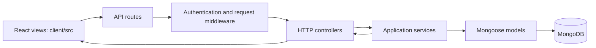

# Server MVC architecture

The Express backend separates MongoDB models, HTTP controllers, routes, middleware, and application services. The React application in `client/src` is the view layer. The server returns JSON and spreadsheet downloads; Express also serves the compiled React application in production.



## Server layout

```text
server/
  .env.example
  package.json
  src/
    index.js                    Server startup, expiry worker, shutdown
    app.js                      Express composition and React static hosting
    config/
      env.js                    Environment configuration; reads server/.env
      database.js               Database connection and index initialization
    models/
      User.js                   Admin/student accounts
      Course.js                 Course definitions
      Exam.js                   Schedules, assignments and exam rules
      Question.js               Question bank and correct answers
      Attempt.js                Answer snapshots, timer and results
      PlatformSettings.js       Student result visibility policy
      schema-options.js         Shared schema options and reference helper
      index.js                  Model exports
    controllers/
      auth.controller.js        Sign-in, sign-out and current user
      profile.controller.js     Profile and admin password changes
      admin.controller.js       Dashboard, result reports and settings
      records.controller.js     Student/course/exam/question CRUD and transfers
      student.controller.js     Student dashboard, exams and attempts
      health.controller.js      Database readiness response
    routes/
      index.js                  API composition and access boundaries
      auth.routes.js            Public sign-in/out; protected current user
      profile.routes.js         Protected account routes
      admin.routes.js           Admin routes and record resources
      student.routes.js         Student exam and result routes
    services/
      auth.service.js           Credential verification and password changes
      session.service.js        Session cookies and public user serialization
      records.service.js        Record validation, relations, CRUD and imports
      attempts.service.js       Attempt quotas, answer saving and grading
      dashboard.service.js      Admin and student dashboard data
      results.service.js        Admin result queries and export rows
      settings.service.js       Persistent visibility policy
      transfers.service.js      CSV/XLSX parsing, templates and downloads
    middleware/
      auth.middleware.js        Session verification and admin authorization
      api.middleware.js         Origin guard, cache policy and API 404
      student-results.middleware.js  Student result visibility enforcement
      upload.middleware.js      In-memory file upload limits
      error.middleware.js       Shared error responses
    validators/
      index.js                  Request and record validation schemas
    utils/
      domain.js                 Grading, access, errors and safe serialization
      birth-dates.js            Date-only birth date validation
    seed.js                     Demo initialization for an empty database
    test/
      domain.test.js
      transfers.test.js
      api.test.js
      result-visibility.test.js
      student-login.test.js
```

## Responsibilities

Routes declare endpoints and connect middleware to controllers. Controllers read HTTP inputs, invoke services and form responses. Services implement application rules and query models. Models define persistent schemas and indexes. Shared middleware handles session checks, authorization, upload limits, result visibility and errors. Pure helpers live under `utils`; Zod request schemas live under `validators`.

The refactor preserves API paths, response fields, status codes, cookie configuration, database collection names, indexes and environment configuration. Existing student records, exams and results require no migration or reseeding. `server/src/index.js` remains the startup entry point and `server/src/seed.js` remains the seed entry point.

## Tests inside src

All five server test files are under `server/src/test`; there is no `server/test` directory in the source or packaged project. They execute only through the test commands and are not imported by server startup or API routes.

From the project root:

```sh
npm test
npm run test:integration
npm run test:student-login -w server
npm run test:visibility -w server
```

Integration tests use disposable MongoDB databases. As before, set `MONGOMS_SYSTEM_BINARY` to a local `mongod` executable to avoid downloading a test binary.

## Packaging

`node scripts/package.mjs` stages the current source in a fresh generated directory before creating `artifacts/Diyaprosoft-LMS-MERN.zip`. This prevents removed flat modules or the old test directory from being included in a subsequent ZIP. Credentials, dependencies, compiled client files and test runtime data remain excluded.
